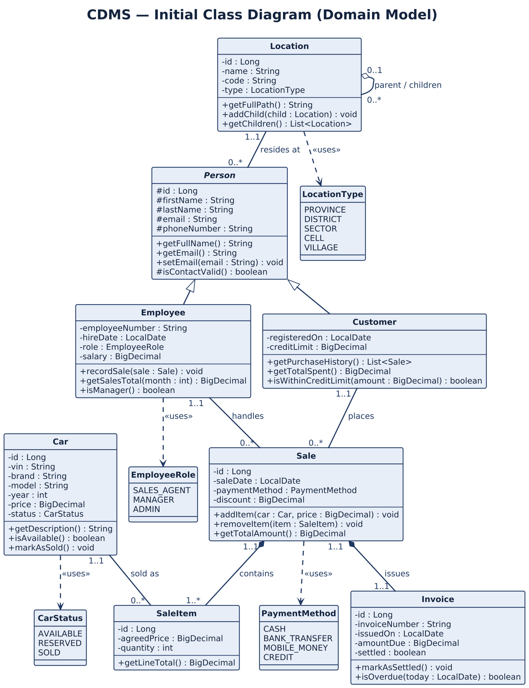
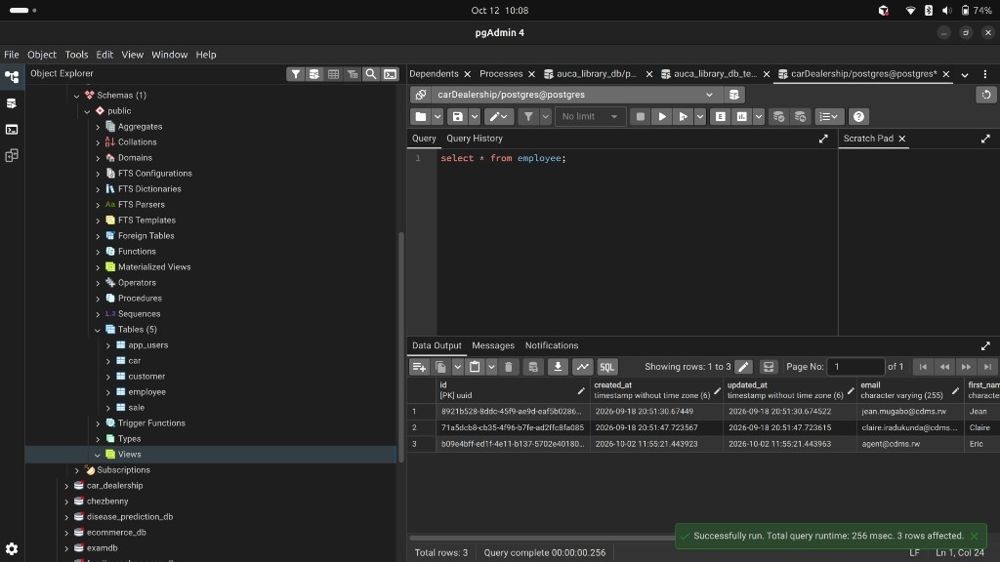
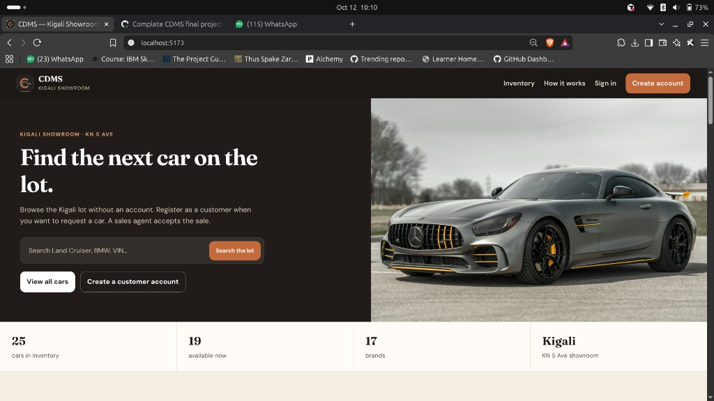
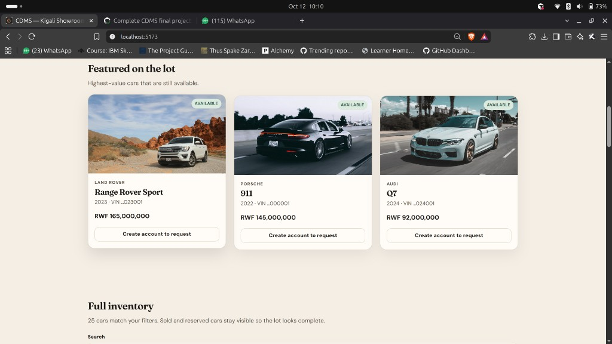
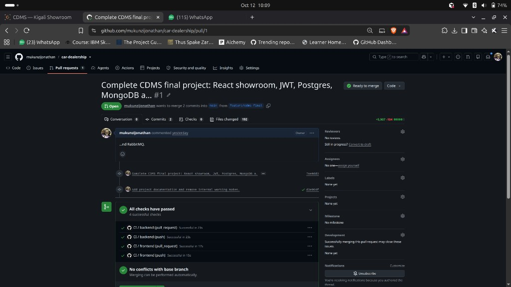

# Car Dealership Management System (CDMS)

**Name:** MUKUNZI Jonathan  
**Registration number:** 27132  
**Institution:** Adventist University of Central Africa  
**Faculty of Information Technology**  
**Course:** INSY 8322 — Web Technology (April 2026–2027)  
**Instructor:** Jeremie U. Tuyisenge  

**GitHub:** https://github.com/mukunzijonathan/car-dealership  
**Pull request into `main`:** https://github.com/mukunzijonathan/car-dealership/pull/1

---

## Abstract

I built CDMS as a web system for a Kigali car showroom. A visitor can browse the lot without an account. A customer creates an account, signs in, and requests a car. A sales agent accepts or rejects that request. PostgreSQL holds cars, people and sales. RabbitMQ carries registration and sale events. MongoDB stores the resulting email, SMS and audit documents. Sign-in uses JWT, with Google OAuth 2.0 available in the security layer. Access to screens and APIs is restricted by role.

---

## Table of contents

1. Problem, users, objectives and requirements  
2. Domain and data modeling  
3. User interface  
4. Architecture and backend  
5. Persistence  
6. Authentication, OAuth 2.0 and RBAC  
7. RabbitMQ  
8. Version control  
9. Testing and DevOps  
10. How to run the system  
11. Conclusion  
12. List of figures  

---

## 1. Problem, users, objectives and requirements

### 1.1 Problem statement

A Kigali car showroom still tracks stock, buyers and sales in notebooks or spreadsheets. Duplicate vehicle identification numbers, a sold car being offered again, and no record of who approved a sale are common. I needed a single web application that records inventory, customers, staff and sale requests, enforces roles, and keeps an audit trail.

### 1.2 Target users

| Actor | Goal |
| --- | --- |
| Visitor | Browse available cars without creating an account |
| Customer | Create an account and request a car |
| Sales agent | Accept or reject a customer request |
| Manager | Supervise stock, customers and sales |
| Administrator | Create staff portal accounts and manage the lot |

### 1.3 Objectives

1. Record every car, customer, employee and sale request.  
2. Stop a reserved or sold car from being sold twice.  
3. Restrict screens and APIs by role.  
4. After a sale is approved, publish a notification event and keep the email, SMS and audit documents.

### 1.4 Scope

**In scope:** public showroom, customer self-registration, staff accounts created by an administrator, sale request and approval, JWT and OAuth 2.0, PostgreSQL, MongoDB, RabbitMQ, and a React interface on localhost.

**Out of scope:** native mobile applications, live payment, and hosting on a public cloud. MongoDB and RabbitMQ run in Docker on this machine.

### 1.5 Business rules

- VIN is unique and exactly 17 characters.  
- A customer may request only an available car; the car becomes reserved.  
- Only staff may approve a request; the car is then marked sold and a RabbitMQ event is published.  
- A rejected request returns the car to available.  
- The last administrator account cannot be deleted.  
- Manager and administrator salaries are at least RWF 500,000.  
- Customers cannot create staff accounts.

### 1.6 Quality attributes

| Attribute | How I measured it |
| --- | --- |
| Usability | Landing, login and showroom work on a laptop without horizontal scroll; layout adapts below 980px and 600px |
| Performance | Inventory lists return in under two seconds on localhost with the seed data |
| Reliability | Sale request and approval run inside a database transaction |
| Security | BCrypt passwords, JWT on protected routes, RBAC on mutating APIs, OAuth 2.0 with Google |

### 1.7 User stories

**US-1 Browse**  
As a visitor I can see cars on the home page so that I know what is on the lot.  
**Acceptance:** `GET /car/search-lot` and `GET /car/search-available` work without a token. Brand, model, year, price, status and photograph are shown.

**US-2 Request**  
As a registered customer I request a car so that a sales agent can complete the sale.  
**Acceptance:** the car becomes `RESERVED`; a `sale` row exists with status `REQUESTED`; I see it under My requests.

**US-3 Approve**  
As a sales agent I accept a request so that the car is marked sold and the customer is notified.  
**Acceptance:** sale `APPROVED`, car `SOLD`; MongoDB `notifications` and `audit_logs` are written; RabbitMQ queues `cdms.notification.email` and `cdms.notification.sms` receive the event.

The use-case model is in `docs/use-case.puml`.

---

## 2. Domain and data modeling

### 2.1 Class diagram

I modelled Person as a generalisation of Customer and Employee. A Sale links one Car, one Customer, and (after approval) one Employee. AppUser is the login identity.

The PlantUML source is `docs/uml-class.puml`. An exported view is shown below.



**Figure 1.** Conceptual class diagram.

- Customer 1 — 0..\* Sale  
- Employee 0..1 — 0..\* Sale (the employee is set only when the sale is approved)  
- Car 1 — 0..1 Sale  

### 2.2 Conceptual model

This section does not depend on tables or frameworks.

**Actors:** visitor, customer, sales agent, manager, administrator, notification service.

**Process:** browse stock → register or sign in → request a sale → staff accept or reject → notify the customer.

**Data objects:** Person, Car, Sale, user account, role, notification document, audit event.

A person is either a customer or an employee. An application user is the email, credential, role and provider used to sign in. Notification and audit records are documents; they are not SQL join tables.

### 2.3 Physical schema

The relational store is PostgreSQL database `carDealership`. Source: `docs/er-schema.puml`.

| Table | Primary key | Constraints and indexes |
| --- | --- | --- |
| `app_users` | `id` UUID | `email` UNIQUE; role in ADMIN, MANAGER, SALES_AGENT, CUSTOMER |
| `car` | `id` UUID | `vin` UNIQUE, length 17; `price > 0`; status AVAILABLE, RESERVED or SOLD |
| `customer` | `id` UUID | `email` UNIQUE |
| `employee` | `id` UUID | `employee_number` UNIQUE; `email` UNIQUE |
| `sale` | `id` UUID | `car_id` UNIQUE FK → car; `customer_id` FK → customer; `employee_id` FK → employee (nullable until approval) |

I confirmed the live schema in pgAdmin. The public schema of `carDealership` contains `app_users`, `car`, `customer`, `employee` and `sale`. A query on `employee` returns the three seeded staff accounts (Jean Mugabo, Claire Iradukunda, Eric Nkusi).



**Figure 2.** pgAdmin connected to `carDealership`. Tables are listed on the left. `SELECT * FROM employee` returns the three staff rows.

MongoDB database `cdms_docs` holds documents:

| Collection | Fields |
| --- | --- |
| `notifications` | channel, recipient, subject, message, relatedSaleId, status, createdAt |
| `audit_logs` | action, actorEmail, details, relatedSaleId, createdAt |

There are no MongoDB foreign keys. `relatedSaleId` stores the sale UUID as a string.

---

## 3. User interface

I implemented the interface in React 19 with Vite. Layout uses CSS Grid and flexbox. Breakpoints are 980px and 600px so the same pages work on a laptop and a narrower window.

| Route | Who uses it | Purpose |
| --- | --- | --- |
| `/` | Public | Showroom, search, brand and price filters |
| `/login` | Public | Email and password; Google when OAuth 2.0 is configured |
| `/register` | Public | Customer self-registration |
| `/app/showroom` | Customer | Request a car and view own requests |
| `/app` | Staff | Dashboard |
| `/app/cars` | Staff | Inventory |
| `/app/sales` | Staff | Accept or reject requests |
| `/app/employees` | Administrator | Create staff and portal passwords |
| `/app/notifications` | Manager, administrator | MongoDB notifications and audit log |

The public landing page at http://localhost:5173 is the main prototype. The hero, statistics strip and featured cars are shown below.



**Figure 3.** Public landing page: showroom heading, search, and inventory counts (25 cars, 19 available, 17 brands).



**Figure 4.** Featured cars a visitor can see without signing in. Requesting a car requires a customer account.

The header, hero and catalogue reflow on a narrow viewport. In the staff portal the sidebar becomes a horizontal strip.

---

## 4. Architecture and backend

I used a layered monolith, not independently deployed microservices.

```
React (http://localhost:5173)
        │  JSON + JWT
        ▼
Spring Boot controllers
        │
        ▼
Application services (transactions and business rules)
        │
   ┌────┴─────┬──────────────┐
   ▼          ▼              ▼
PostgreSQL   MongoDB      RabbitMQ
```

The React client calls HTTP controllers. Controllers call services. Services call Spring Data repositories. Java packages are organised by feature under `rw.ac.auca`: `car`, `customer`, `employee`, `sale`, `user`, `notification`, `messaging`, `security`.

The backend is Spring Boot. Hibernate `ddl-auto=update` keeps the relational schema. Demo users and cars are inserted only when they are missing, so a restart does not wipe sales.

---

## 5. Persistence

| Store | Engine | Database | Contents |
| --- | --- | --- | --- |
| Relational | PostgreSQL on the host, managed in pgAdmin | `carDealership` | cars, customers, employees, sales, users |
| Non-relational | MongoDB 7 in Docker (`cdms-mongo`) | `cdms_docs` | `notifications`, `audit_logs` |

PostgreSQL is the system of record for a sale. MongoDB stores the messages produced after registration or approval. Both stores are used at runtime.

---

## 6. Authentication, OAuth 2.0 and authorization

### 6.1 Local accounts

Customers register with `POST /auth/register`. That call creates a `customer` row and an `app_users` row. Passwords are hashed with BCrypt. `POST /auth/login` returns a JWT. The React client sends `Authorization: Bearer <token>` on later requests. Staff accounts are created only by an administrator, who also sets the portal password.

### 6.2 OAuth 2.0

I implemented OAuth 2.0 with Spring Security’s authorization-code flow and Google as the identity provider (`/oauth2/authorization/google`). After Google authenticates the user, the success handler:

1. Reads email, name and subject from the Google profile.  
2. Creates an `app_users` row with provider `GOOGLE` if the email is new.  
3. Creates the matching `customer` row so the person can request a car.  
4. Issues the same JWT as password login and redirects to the React callback.

Client id and secret come from environment variables `GOOGLE_CLIENT_ID` and `GOOGLE_CLIENT_SECRET`. They are not stored in the repository. The redirect URI is:

`http://localhost:8080/login/oauth2/code/google`

If those variables are unset, email and password still work. The OAuth 2.0 endpoints remain in `SecurityConfig`.

### 6.3 Role-based access control

| Role | What the user can do |
| --- | --- |
| Visitor | Browse the lot |
| CUSTOMER | Register, request a car, see own sales |
| SALES_AGENT | Inventory, accept or reject requests |
| MANAGER | Customers, all sales, notification documents |
| ADMIN | All of the above, plus staff accounts |

I enforced this with `@PreAuthorize` on controllers and the JWT filter. The React sidebar only shows links allowed for the signed-in role.

### 6.4 Performance

Public inventory is one GET. Vite proxies API calls during development. The seed set is about 25 cars, which stays well under two seconds on localhost.

---

## 7. RabbitMQ

RabbitMQ 3 runs in Docker (`cdms-rabbitmq`). The management console is http://localhost:15672 (user `guest`).

| Queue | When it is used |
| --- | --- |
| `cdms.account.registered` | A customer account is created |
| `cdms.sale.created` | A staff member approves a sale |
| `cdms.notification.email` | Email document is written |
| `cdms.notification.sms` | SMS document is written |

Listeners do not send mail through Gmail or SMS through a telecom operator. They write `notifications` documents in MongoDB with status `SENT`. That keeps the demo on localhost and still uses the broker for email, SMS and other events.

---

## 8. Version control

I hosted the project at https://github.com/mukunzijonathan/car-dealership. I worked on branch `feature/cdms-final` and opened pull request **#1** into `main`. GitHub Actions compiled the backend and built the frontend; all checks passed.

https://github.com/mukunzijonathan/car-dealership/pull/1



**Figure 5.** Pull request #1, `feature/cdms-final` into `main`. CI jobs for backend and frontend succeeded. There are no merge conflicts.

---

## 9. Testing and DevOps

**DevOps.** `docker-compose.yml` starts MongoDB and RabbitMQ. `.github/workflows/ci.yml` compiles Spring Boot and builds the React application on each push. That is the same pipeline shown as green on the pull request.

**Testing.** I verified the API with Postman (`postman/CDMS.postman_collection.json`). Sample bodies are in `postman/DUMMY-DATA.md`. Automated JUnit coverage is limited; the collection is the main API check.

**Other technologies I used:** JWT, OAuth 2.0, React, Docker Compose, RabbitMQ and MongoDB together with PostgreSQL.

---

## 10. How to run the system

Prerequisites: PostgreSQL with database `carDealership`, Docker, JDK 21, Maven, Node.js.

```bash
docker compose up -d
cd backend && mvn spring-boot:run
```

```bash
cd frontend && npm install && npm run dev
```

| Service | Address |
| --- | --- |
| User interface | http://localhost:5173 |
| API | http://localhost:8080 |
| RabbitMQ console | http://localhost:15672 (`guest` / `guest`) |
| MongoDB | `mongodb://localhost:27017`, database `cdms_docs` |

| Role | Email | Password |
| --- | --- | --- |
| Administrator | admin@cdms.rw | Admin#123 |
| Manager | manager@cdms.rw | Manager#123 |
| Sales agent | agent@cdms.rw | Agent#123 |
| Customer | customer@cdms.rw | Customer#123 |

Google sign-in, when a client is registered in Google Cloud:

```bash
export GOOGLE_CLIENT_ID='…'
export GOOGLE_CLIENT_SECRET='…'
```

---

## 11. Conclusion

I took a real showroom problem through requirements, conceptual and physical modelling, a React interface, a layered Spring Boot API, PostgreSQL and MongoDB, OAuth 2.0 and JWT, RBAC, RabbitMQ, and a pull request into `main`. Email and SMS are stored as broker-backed documents rather than sent through a public mail or SMS provider, which matches a localhost academic deployment.

---

## 12. List of figures

| Figure | File | Description |
| --- | --- | --- |
| 1 | `figures/class-diagram.png` | Conceptual class diagram |
| 2 | `figures/pgadmin-employee.png` | PostgreSQL `carDealership` in pgAdmin |
| 3 | `figures/landing-hero.jpg` | Public landing page |
| 4 | `figures/landing-featured.jpg` | Featured cars |
| 5 | `figures/github-pr.png` | Pull request #1 with CI passing |

PlantUML sources: `uml-class.puml`, `er-schema.puml`, `use-case.puml`.
