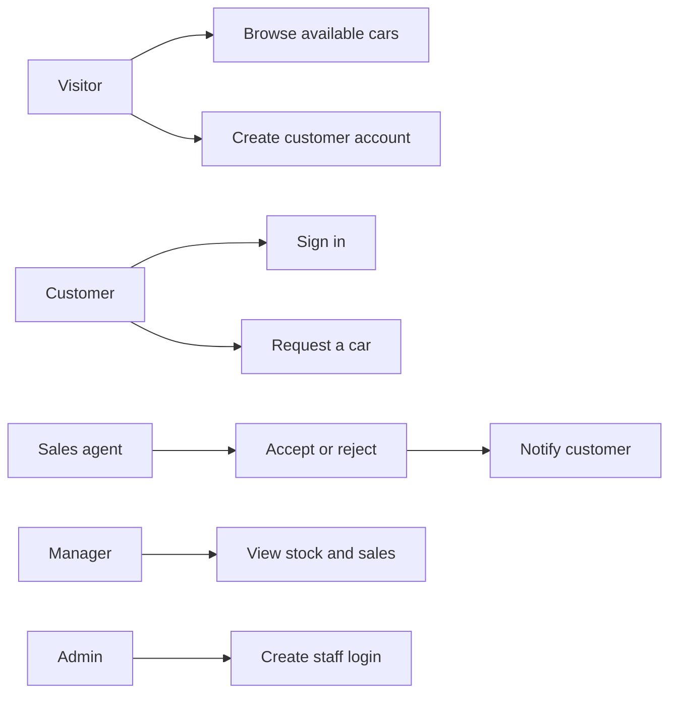
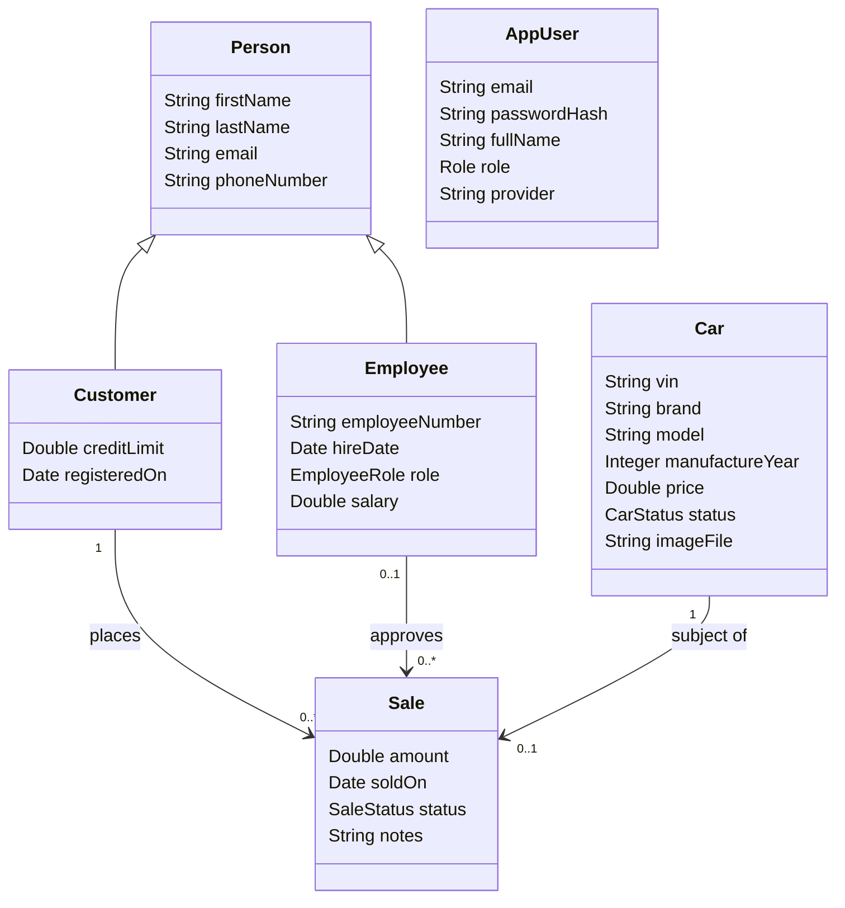
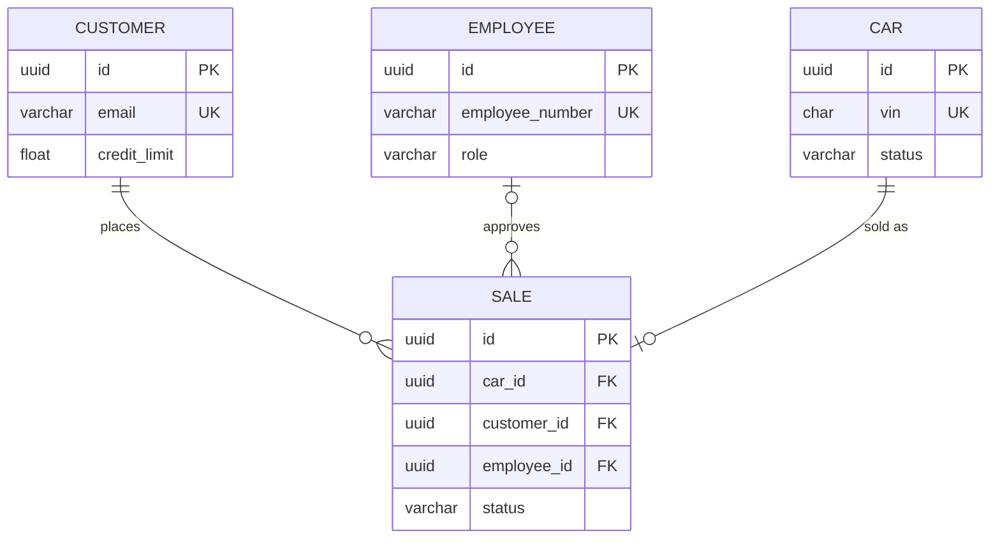

# Car Dealership Management System (CDMS)

**Student:** MUKUNZI Jonathan  
**Registration number:** 27132  
**Institution:** Adventist University of Central Africa  
**Faculty:** Information Technology  
**Course:** INSY 8322 — Web Technology  
**Session:** April 2026–2027  
**Repository:** https://github.com/mukunzijonathan/car-dealership  
**Pull request:** https://github.com/mukunzijonathan/car-dealership/pull/1

---

## Abstract

CDMS is a web-based system for a Kigali car showroom. Visitors browse inventory without an account. Customers register, sign in, and request a vehicle. Sales staff accept or reject the request. Operational records are stored in PostgreSQL. Sale and registration events travel through RabbitMQ. Email, SMS and audit documents are stored in MongoDB. Access is controlled with JWT authentication, optional Google OAuth 2.0, and role-based authorization.

---

## Table of contents

1. Problem, users, objectives and requirements  
2. Domain and data modeling  
3. User interface design  
4. Architecture and backend implementation  
5. Persistence  
6. Authentication, OAuth 2.0 and RBAC  
7. Messaging with RabbitMQ  
8. Version control  
9. Quality, testing and DevOps  
10. How to run the system  
11. Conclusion  

---

## 1. Problem, users, objectives and requirements

*(Mid-term items 1 — 10 marks)*

### 1.1 Problem statement

A Kigali car showroom still tracks stock, buyers and sales in notebooks or spreadsheets. Duplicate vehicle identification numbers (VIN), a sold car being offered again, and no record of who approved a sale are common. The business needs a single web application that records inventory, customers, staff and sale requests, enforces roles, and keeps an audit trail of completed sales.

### 1.2 Target users

| Actor | Goal |
| --- | --- |
| Visitor | Browse available cars without creating an account |
| Customer | Create an account and request a car |
| Sales agent | Accept or reject a customer request |
| Manager | Supervise stock, customers and sales |
| Administrator | Create staff portal accounts and manage the lot |

### 1.3 Objectives

1. Record every car, customer, employee and sale request.  
2. Prevent a reserved or sold car from being sold twice.  
3. Restrict screens and APIs by role.  
4. After a sale is approved, publish a notification event and persist the resulting email, SMS and audit documents.

### 1.4 Scope

**In scope:** public showroom, customer self-registration, staff accounts created by an administrator, sale request and approval, JWT and OAuth 2.0, PostgreSQL, MongoDB, RabbitMQ, and a React user interface on localhost.

**Out of scope:** native mobile applications, live payment gateways, and production hosting on a public cloud (Docker Compose is used for local infrastructure).

### 1.5 Functional / business rules

- VIN is unique and exactly 17 characters.  
- A customer may request only an available car; the car becomes reserved.  
- Only staff may approve a request; the car is then marked sold and a RabbitMQ event is published.  
- A rejected request returns the car to available.  
- The last administrator account cannot be deleted.  
- Manager and administrator salaries are at least RWF 500,000.  
- Customers cannot create staff accounts.

### 1.6 Quality attributes

| Attribute | Measure |
| --- | --- |
| Usability | Landing, login and showroom usable on a laptop browser without horizontal scroll; layout adapts below 980px and 600px |
| Performance | Inventory list endpoints return in under two seconds on localhost with the seed data set |
| Reliability | Sale request and approval run inside a database transaction |
| Security | Passwords stored with BCrypt; JWT on protected routes; RBAC on every mutating API; OAuth 2.0 available for Google sign-in |

### 1.7 User stories and acceptance criteria

**US-1 Browse**  
As a visitor I can see cars on the home page so that I know what is on the lot.  
**Acceptance:** `GET /car/search-lot` and `GET /car/search-available` succeed without a token; brand, model, year, price, status and photograph are displayed.

**US-2 Request**  
As a registered customer I request a car so that a sales agent can complete the sale.  
**Acceptance:** car status becomes `RESERVED`; a `sale` row exists with status `REQUESTED`; the request appears under My requests.

**US-3 Approve**  
As a sales agent I accept a request so that the car is marked sold and the customer is notified.  
**Acceptance:** sale status `APPROVED`, car status `SOLD`; MongoDB `notifications` and `audit_logs` documents are written; RabbitMQ queues `cdms.notification.email` and `cdms.notification.sms` receive the event.

Use-case diagram: `docs/use-case.puml`.



---

## 2. Domain and data modeling

*(Mid-term items 2–4 — 20 marks)*

### 2.1 UML class diagram

Source: `docs/uml-class.puml`.



Multiplicity: one customer places many sales; one car has at most one sale; an employee is attached only after approval.

### 2.2 Conceptual model

This section is independent of tables and frameworks.

**Actors:** visitor, customer, sales agent, manager, administrator, notification service.

**Processes:** browse stock → register or sign in → request a sale → staff accept or reject → notify the customer.

**Data objects:** Person, Car, Sale, user account, role, notification document, audit event.

- A person is either a customer or an employee.  
- An `AppUser` is the login identity (email, credential, role, provider).  
- A sale links one car, one customer, and (after approval) one employee.  
- Notification and audit records are documents. They are not joined with SQL foreign keys.

### 2.3 Physical schema

Source: `docs/er-schema.puml`.

**PostgreSQL database `carDealership` (operational data)**

| Table | Primary key | Constraints and indexes |
| --- | --- | --- |
| `app_users` | `id` UUID | `email` UNIQUE; `role` in {ADMIN, MANAGER, SALES_AGENT, CUSTOMER} |
| `car` | `id` UUID | `vin` UNIQUE, length 17; `price > 0`; `status` in {AVAILABLE, RESERVED, SOLD} |
| `customer` | `id` UUID | `email` UNIQUE; `credit_limit >= 0` |
| `employee` | `id` UUID | `employee_number` UNIQUE; `email` UNIQUE |
| `sale` | `id` UUID | `car_id` UNIQUE FK → `car`; `customer_id` FK → `customer`; `employee_id` FK → `employee` (nullable until approval); `sold_on` nullable |



**MongoDB database `cdms_docs` (documents)**

| Collection | Fields |
| --- | --- |
| `notifications` | channel, recipient, subject, message, relatedSaleId, status, createdAt |
| `audit_logs` | action, actorEmail, details, relatedSaleId, createdAt |

There are no MongoDB foreign keys. `relatedSaleId` stores the sale UUID as a string.

---

## 3. User interface design

*(Final-term item 1 — 10 marks)*

The interface is a React 19 single-page application built with Vite. Layout uses CSS Grid and flexbox with breakpoints at 980px and 600px.

| Route | Audience | Purpose |
| --- | --- | --- |
| `/` | Public | Showroom, search, brand and price filters |
| `/login` | Public | Email/password sign-in; Google OAuth 2.0 when configured |
| `/register` | Public | Customer self-registration |
| `/app/showroom` | Customer | Request a car; view own requests |
| `/app` | Staff | Dashboard and inventory snapshot |
| `/app/cars` | Staff | Inventory create / update |
| `/app/sales` | Staff | Accept or reject requests |
| `/app/employees` | Administrator | Create staff and portal passwords |
| `/app/notifications` | Manager, administrator | MongoDB notification and audit documents |

Wireframes are realised by the running application. Evidence for layout adaptability is a wide desktop capture of `/` and the same page at approximately 400px (browser device mode). The public header, hero, catalogue and footer reflow; the staff portal sidebar becomes a horizontal strip on small screens.

---

## 4. Architecture and backend implementation

*(Final-term item 2 — 15 marks)*

CDMS is a **layered monolith**. It is not a set of independently deployed microservices. Layers communicate in one direction: the React client calls HTTP controllers; controllers call application services; services call Spring Data repositories.

```text
React (http://localhost:5173)
        │  JSON + JWT
        ▼
Spring Boot controllers
        │
        ▼
Application services (transactions, business rules)
        │
   ┌────┴─────┬──────────────┐
   ▼          ▼              ▼
PostgreSQL   MongoDB      RabbitMQ
(JPA)        (documents)  (events)
```

Java packages are organised by feature under `rw.ac.auca`: `car`, `customer`, `employee`, `sale`, `user`, `notification`, `messaging`, `security`.

The backend is Spring Boot. Hibernate `ddl-auto=update` maintains the relational schema. Demo data is inserted only when missing, so a restart does not wipe sales.

---

## 5. Persistence

*(Final-term item 3 — 5 marks)*

| Store | Engine | Database | Contents |
| --- | --- | --- | --- |
| Relational | PostgreSQL on the host (pgAdmin) | `carDealership` | cars, customers, employees, sales, users |
| Non-relational | MongoDB 7 in Docker (`cdms-mongo`) | `cdms_docs` | `notifications`, `audit_logs` |

PostgreSQL is the system of record for the sale. MongoDB stores the messages produced after registration or approval. Both are required by the brief and both are used at runtime.

---

## 6. Authentication, OAuth 2.0 and authorization

*(Final-term item 4 — 5 marks)*

### 6.1 Local accounts

Customers register at `POST /auth/register`. The service creates a `customer` row and an `app_users` row. The password is hashed with BCrypt. Login at `POST /auth/login` returns a signed JWT. The React client sends `Authorization: Bearer <token>` on subsequent calls. Staff accounts are created only by an administrator, who also sets the portal password.

### 6.2 OAuth 2.0

OAuth 2.0 is implemented with Spring Security’s authorization-code flow and Google as the identity provider (`/oauth2/authorization/google`). On success the handler:

1. Reads the Google profile (email, name, subject).  
2. Creates an `app_users` row with provider `GOOGLE` if the email is new.  
3. Creates the matching `customer` row so the user can request a car.  
4. Issues the same JWT used by password login and redirects to the React callback.

Client identifier and secret are supplied as environment variables `GOOGLE_CLIENT_ID` and `GOOGLE_CLIENT_SECRET`. They are not committed. The authorized redirect URI is:

`http://localhost:8080/login/oauth2/code/google`

When those variables are unset, email-and-password login remains available. The OAuth 2.0 endpoints and success handler stay in the security configuration.

### 6.3 Role-based access control

| Role | Capabilities |
| --- | --- |
| Visitor | Browse the lot |
| CUSTOMER | Register, request a car, view own sales |
| SALES_AGENT | Inventory, accept or reject requests |
| MANAGER | Customers, all sales, notification documents |
| ADMIN | All of the above, plus staff accounts |

Enforcement is `@PreAuthorize` on controllers together with the JWT filter. The React sidebar renders only the links allowed for the signed-in role.

### 6.4 Performance

JSON list endpoints return the persisted collection without extra round-trips beyond JPA fetch of the sale graph. The public lot is a single GET. Vite proxies API calls on the development server so the browser does not wait on CORS preflights for each resource. Seeded inventory (about 25 cars) is sized for sub-second local responses.

---

## 7. Messaging with RabbitMQ

*(Final-term item 5 — 3 marks)*

RabbitMQ 3 runs in Docker (`cdms-rabbitmq`). The management console is http://localhost:15672 (user `guest`).

| Queue | When it is used |
| --- | --- |
| `cdms.account.registered` | A customer account is created |
| `cdms.sale.created` | A staff member approves a sale |
| `cdms.notification.email` | Email document is written |
| `cdms.notification.sms` | SMS document is written |

Listeners do not send mail through Gmail or SMS through a telecom gateway. They persist `notifications` documents in MongoDB with status `SENT`. That satisfies the broker requirement and keeps the demo fully local.

---

## 8. Version control

*(Final-term item 6 — 2 marks)*

The project is hosted at https://github.com/mukunzijonathan/car-dealership. Work was committed on branch `feature/cdms-final` and submitted as pull request **#1** into `main`:

https://github.com/mukunzijonathan/car-dealership/pull/1

---

## 9. Quality, testing and DevOps

*(Bonus)*

**DevOps.** `docker-compose.yml` starts MongoDB and RabbitMQ as named containers. A GitHub Actions workflow (`.github/workflows/ci.yml`) compiles the Spring Boot module and builds the React application on each push.

**Testing.** A Postman collection (`postman/CDMS.postman_collection.json`) covers login, cars, customers, staff and sales. Dummy payloads are listed in `postman/DUMMY-DATA.md`. Automated JUnit coverage is limited; API verification is performed with the collection.

**Technologies used beyond a basic CRUD tutorial:** JWT, OAuth 2.0, React, Docker Compose, RabbitMQ and MongoDB alongside PostgreSQL.

---

## 10. How to run the system

**Prerequisites:** PostgreSQL with database `carDealership`, Docker, JDK 21, Maven, Node.js.

```bash
docker compose up -d
cd backend && mvn spring-boot:run
# other terminal
cd frontend && npm install && npm run dev
```

- User interface: http://localhost:5173  
- API: http://localhost:8080  
- RabbitMQ console: http://localhost:15672 (`guest` / `guest`)  
- MongoDB: `mongodb://localhost:27017`, database `cdms_docs`

| Role | Email | Password |
| --- | --- | --- |
| Administrator | admin@cdms.rw | Admin#123 |
| Manager | manager@cdms.rw | Manager#123 |
| Sales agent | agent@cdms.rw | Agent#123 |
| Customer | customer@cdms.rw | Customer#123 |

Optional Google sign-in:

```bash
export GOOGLE_CLIENT_ID='…'
export GOOGLE_CLIENT_SECRET='…'
```

---

## 11. Conclusion

CDMS takes a real showroom problem through requirements, conceptual and physical modeling, a responsive React interface, a layered Spring Boot API, two persistence technologies, OAuth 2.0 and JWT security, RBAC, RabbitMQ events, and a GitHub pull request into `main`. Email and SMS are represented as broker-backed documents rather than live telecom messages, which is appropriate for a localhost academic deployment.

**Figures in this folder**

| File | Content |
| --- | --- |
| `uml-class.puml` | Conceptual class diagram |
| `er-schema.puml` | Physical schema |
| `use-case.puml` | Use-case diagram |
| `class-diagram.png` | Earlier exported class diagram |
